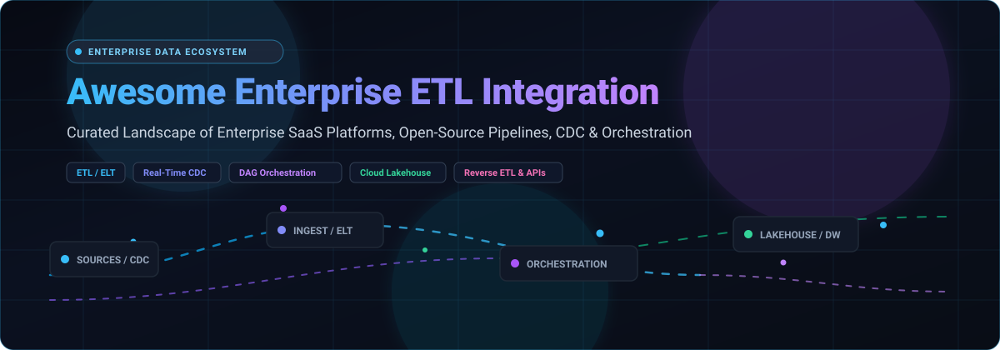

  

# 🚀 Awesome-Enterprise-ETL-Integration

  
  
  
  
  
  

## ⚡ Top Enterprise ETL Integration Ecosystem: Curated SaaS Platforms & Open-Source Tools

> A comprehensive, production-tested curated list of **Enterprise ETL (Extract, Transform, Load)** platforms, **ELT data pipelines**, **Change Data Capture (CDC)** engines, and **pipeline orchestration** frameworks for modern data engineering.

*Last updated: March 2026 • Curated for Data Engineers, Analytics Engineers & Enterprise Architects*

---

### 🌐 Overview & Architecture Scope

Modern enterprise data architectures rely on robust data movement and transformation layers to bridge transactional databases, SaaS applications, cloud data warehouses (Snowflake, Google BigQuery, Amazon Redshift), and open data lakehouses (Databricks, Apache Iceberg, Apache Hudi).

This repository categorizes the top **SaaS / Hosted Platforms** (evaluated by market cap, pricing models, and free tier limits) and active **Open-Source GitHub Projects** (ranked by GitHub star count).

#### 🧩 Modern Data Integration Patterns Covered:
- 🔄 **ETL (Extract, Transform, Load)**: Traditional and distributed batch transformations (IBM DataStage, Apache SeaTunnel, Pentaho).
- ⚡ **ELT (Extract, Load, Transform)**: In-warehouse pushdown data transformations (Fivetran, Matillion, Airbyte, dbt-core).
- 📡 **CDC (Change Data Capture)**: Low-latency, log-based database replication (Debezium, Qlik Replicate, PeerDB, OLake).
- ⏱️ **Workflow Orchestration**: Programmatic and declarative DAG scheduling engines (Apache Airflow, Kestra, Prefect, Dagster).
- 🔁 **Reverse ETL & Activation**: Syncing warehouse analytical models back to SaaS operational tools (Salesforce, HubSpot, Zendesk).

---

## 📑 Table of Contents

- 📊 [Sector Overview & Market Dynamics](#sector-overview--market-dynamics)
- 🏢 [Enterprise SaaS & Hosted Platforms](#enterprise-saas--hosted-platforms)
- 🛠️ [Open-Source GitHub Projects](#open-source-github-projects)
- 📐 [Architecture Patterns & Selection Guide](#architecture-patterns--selection-guide)
- 🤝 [How to Contribute](#how-to-contribute)
- ⚖️ [Disclaimer](#disclaimer)

---

## 📊 Sector Overview & Market Dynamics

The global Data Integration and ETL market is estimated at **$14.3 billion to $17.5 billion in 2025–2026** and is projected to surpass **$30 billion by 2030**, advancing at a robust Compound Annual Growth Rate (CAGR) of **~11% to 14%**, propelled by enterprise cloud data lakehouse adoption and AI/LLM data readiness pipelines.

The sector is **moderately to highly fragmented** rather than a winner-take-all monopoly. While hyperscale cloud providers (AWS, Azure, GCP) and legacy enterprise giants (Informatica, IBM) maintain foundational contracts, specialized modern ELT vendors (Fivetran, Matillion) and vibrant open-source ecosystems (Airbyte, Airflow, SeaTunnel, Meltano) command significant, thriving market shares across diverse multi-cloud, hybrid, and real-time streaming architectures.

## 🏢 Enterprise SaaS & Hosted Platforms

| 🏢 Platform / Product | 📈 Company Size & Valuation | 💳 Pricing (Starting Tier) | 🎁 Free Tier Limits | ⚙️ Key Capabilities & Architecture |
| :--- | :--- | :--- | :--- | :--- |
| **[AWS Glue](https://aws.amazon.com/glue/)** | **~$2.1T Market Cap** (Amazon) / $105B+ AWS Revenue | $0.44 per DPU-hour (Data Processing Unit-Hour), billed per second with 1-minute minimum | Free forever for 1M Data Catalog requests/month and 1M objects stored; 40 DPU-hours free trial for first 30 days | Fully managed serverless ETL engine with Data Catalog metadata, automatic script generation, and event scheduling. |
| **[Salesforce Informatica Connector](https://www.informatica.com/)** | **~$280B Market Cap** (Salesforce) / $10.5B Valuation (Informatica) | Pay-as-you-go from $90–$100/IPU; starting enterprise packages from $3,000/month | Free forever plan (CDI-Free) up to 20M rows/month (ELT) or 10 processing hours/month (ETL); 30-day enterprise trial | Bidirectional Salesforce data synchronization, bulk API operations, and real-time integration with Informatica IDMC. |
| **[IBM DataStage](https://www.ibm.com/products/datastage)** | **~$215B Market Cap** (IBM) / $62B+ Annual Revenue | $1.75 per Capacity Unit-Hour (CUH); Small Enterprise bundle starting at $1,050/month for 5,000 CUH | Lite Plan free forever with 15 CUH/month; 30-day IBM Cloud trial with $200 free credit | Enterprise parallel processing engine under IBM watsonx.data with hundreds of pre-built transformation functions. |
| **[Pentaho Cloud](https://www.hitachivantara.com/)** | **~$105B Market Cap** (Hitachi) / $65B+ Revenue ($3.5B Vantara) | Starting at $3.57/hour on AWS Marketplace; standard core licenses start at $4,761/year (~$396.75/month) | 30-day free trial with complete access to Pentaho Data Integration (PDI) visual workflow designer | Cloud deployment of Pentaho Data Integration (Kettle) with graphical transformation canvas and data flow tools. |
| **[Qlik Replicate](https://www.qlik.com/)** | **~$10.0B Valuation** (Thoma Bravo) / $1.0B+ Revenue | Starting enterprise tier from $1,000/month ($12,000/year for Qlik Talend Data Integration Cloud) | 14-day free trial for cloud data integration; assisted 30-day CDC proof-of-concept for enterprise sources | Real-time database replication and log-based CDC across Snowflake, BigQuery, Redshift, SAP, and PostgreSQL. |
| **[Fivetran](https://www.fivetran.com/)** | **$5.6B Valuation** (Series D) / $250M+ ARR | Standard tier at ~$500 / 1M MAR (Monthly Active Rows) + $5/month base connection fee; credit model ~$2.00/credit | Free forever plan up to 500,000 MAR/month across 700+ connectors; 14-day unlimited row trial | Fully managed ELT platform with 700+ pre-built connectors, automated schema drift handling, and automated syncs. |
| **[Boomi Data Integration](https://boomi.com/)** | **$4.0B Valuation** (Acquisition) / $400M+ ARR | Pay-As-You-Go plan starting at $99/month (plus per-message fees); Base Enterprise tiers from $2,000/month | 30-day free trial in AtomSphere sandbox (limited to 3 standard and 3 test connectors) | Cloud-native ELT & iPaaS with no-code interface, 300+ pre-built connectors, API management, and reverse ETL. |
| **[Talend Cloud](https://www.talend.com/)** | **$2.4B Valuation** (Acquisition) / $350M+ ARR | Starting at $1,170/user/month (billed annually at $14,040/user/year) for Talend Data Management Platform | 14-day free trial with full platform access and connector catalog (no credit card required) | Managed ELT with 900+ connectors, data quality governance, profiling, and API services (Talend Open Studio is obsolete). |
| **[Matillion](https://www.matillion.com/)** | **$1.5B Valuation** (Series E Unicorn) / $100M+ ARR | Basic / Teams tier at $2.00/credit (starting bundle at $500/month for 250 credits or $1,000/month for 500 credits) | Free Developer edition for 1 user; 14-day free trial with 500 usage credits | Cloud-native ELT with SQL pushdown transformations, visual pipeline canvas, and Data Loader CDC agents. |
| **[SnapLogic](https://www.snaplogic.com/)** | **$1.0B Valuation** (Series G Unicorn) / $100M+ ARR | Starting package at $9,995/year (~$833/month) for base pipeline endpoints and core Snaps | 30-day assisted proof-of-concept trial with access to 500+ pre-built Snaps and AI Iris integration assistant | Generative Integration Platform featuring Agent Snap for autonomous agent execution and enterprise governance. |

## 🛠️ Open-Source GitHub Projects

- **[Apache Airflow](https://github.com/apache/airflow)**   
  Most widely adopted workflow orchestration and data pipeline platform (Apache-2.0). Programmatic Python-defined DAGs, massive operator ecosystem, and flexible task dependency management for complex ETL/ELT pipelines.

- **[Kestra](https://github.com/kestra-io/kestra)**   
  Declarative, event-driven data orchestrator and workflow automation platform (Apache-2.0). Manage millions of scheduled and event-triggered ETL pipelines with YAML definitions and language-agnostic plugins.

- **[Prefect](https://github.com/prefecthq/prefect)**   
  Modern Python workflow orchestrator and coordination engine for data engineering (Apache-2.0). Turn Python scripts into resilient, observable ETL pipelines using intuitive `@flow` and `@task` decorators.

- **[Airbyte](https://github.com/airbytehq/airbyte)**   
  Premier open-source data integration platform for ELT pipelines (ELv2). Features 350+ pre-built connectors to sync data seamlessly from databases, applications, and APIs into modern data warehouses and lakes.

- **[Dagster](https://github.com/dagster-io/dagster)**   
  Cloud-native orchestrator for machine learning, analytics, and data engineering (Apache-2.0). Emphasizes software-defined data assets, integrated lineage tracking, and testable ETL workflows.

- **[Apache DolphinScheduler](https://github.com/apache/dolphinscheduler)**   
  Distributed, extensible visual workflow orchestration platform (Apache-2.0). Designed to solve complex big data task dependencies with low-latency DAG scheduling and multi-tenant isolation.

- **[dbt-core](https://github.com/dbt-labs/dbt-core)**   
  Industry-standard framework for transforming data inside cloud data warehouses (Apache-2.0). Brings software engineering best practices—such as modular SQL, automated testing, documentation, and version control—to the "T" in ELT.

- **[Debezium](https://github.com/debezium/debezium)**   
  Distributed Change Data Capture (CDC) platform built on top of Apache Kafka (Apache-2.0). Captures row-level database changes from MySQL, PostgreSQL, Oracle, MongoDB, and SQL Server in real-time.

- **[Apache SeaTunnel](https://github.com/apache/seatunnel)**   
  Next-generation high-performance, distributed data integration platform (Apache-2.0). Synchronizes vast amounts of enterprise data daily with 100+ connectors covering batch, streaming, and CDC via SeaTunnel Zeta Engine, Flink, and Spark.

- **[Mage](https://github.com/mage-ai/mage-ai)**   
  Open-source data pipeline and integration tool (Apache-2.0). Features an interactive notebook UI for developing and managing modular, scalable batch and streaming data pipelines with Python and SQL.

- **[Apache NiFi](https://github.com/apache/nifi)**   
  Flow-based programming system for visual data pipeline design, real-time routing, and mediation (Apache-2.0). Enterprise-grade data governance with end-to-end data provenance tracking.

- **[PeerDB](https://github.com/PeerDB-io/peerdb)**   
  High-speed, cost-effective data replication engine specialized for PostgreSQL (Apache-2.0). Streams CDC data in real time from Postgres into Snowflake, BigQuery, ClickHouse, and queues with sub-second latency.

- **[Meltano](https://github.com/meltano/meltano)**   
  Declarative, code-first data integration engine and CLI for ELT+ (MIT). Built on the open Singer protocol with 600+ connectors available on MeltanoHub for version-controlled, production-grade pipelines.

- **[Hamilton](https://github.com/DAGWorks-Inc/hamilton)**   
  Modular, micro-framework for modeling dataflows with clean Python functions (BSD-3-Clause). Automatically derives DAG lineage, unit tests, and self-documenting data transformation pipelines.

- **[Mara Pipelines](https://github.com/mara/mara-pipelines)**   
  Lightweight, opinionated Python ETL framework (MIT) bridging the gap between simple scripts and complex workflow orchestrators, focused on transparency and fast execution.

- **[Kiba](https://github.com/thbar/kiba)**   
  Lightweight, reliable data processing and ETL framework for Ruby (LGPL). Streamlines pipeline writing with clean single-responsibility components and composable transforms.

- **[Dozer](https://github.com/getdozer/dozer)**   
  Real-time data integration and CDC movement engine (Apache-2.0). Ingests data instantaneously from database write-ahead logs and pushes into low-latency analytical endpoints and streaming sinks.

- **[Apache Hop](https://github.com/apache/hop)**   
  Metadata-driven visual data orchestration platform (Apache-2.0), successor to Pentaho PDI. Features 400+ plugins and executes pipelines across Spark, Flink, and Apache Beam.

- **[OLake](https://github.com/datazip-inc/olake)**   
  Fastest open-source tool for replicating databases to data lakes in open table formats like Apache Iceberg (Apache-2.0). Real-time CDC ingestion from Postgres, MongoDB, and MySQL.

- **[Addax](https://github.com/wgzhao/Addax)**   
  Versatile, distributed bulk ETL data transfer tool (Apache-2.0). Seamlessly exchanges high-volume data across RDBMS, NoSQL databases, and cloud object stores.

- **[Sling CLI](https://github.com/slingdata-io/sling-cli)**   
  Lightweight, high-speed CLI data movement tool (MIT). Extracts data from source databases/storage and loads into target warehouses with minimal overhead and YAML configuration.

- **[Kuwala](https://github.com/kuwala-io/kuwala)**   
  Modular data platform (MIT) uniting Airbyte, dbt, and Great Expectations into an integrated workflow canvas for non-engineers and analytics engineers.

- **[ReplicaDB](https://github.com/osalvador/ReplicaDB)**   
  Open-source cross-database replication tool (MIT). Designed for fast bulk data replication between relational and non-relational database engines.

- **[Versatile Data Kit](https://github.com/vmware/versatile-data-kit)**   
  Data engineering framework by VMware (Apache-2.0) that simplifies developing, testing, deploying, and operating SQL and Python data pipelines.

- **[Astro SDK](https://github.com/astronomer/astro-sdk)**   
  Rapid ELT workflow development SDK powered by Apache Airflow (Apache-2.0). Write modular Python and SQL DAGs with native pandas, Snowflake, and BigQuery interoperability.

- **[PyAirbyte](https://github.com/airbytehq/PyAirbyte)**   
  Official Python library bringing Airbyte's 300+ managed connectors into standard Python scripts, Jupyter notebooks, and custom ETL pipelines.

💡 **Frameworks for building custom systems**: Combine **Apache SeaTunnel** or **Apache NiFi** as the ingestion and orchestration core with **Airbyte** or **Meltano** for declarative connector-based ELT, **dbt-core** for in-warehouse data transformations, **Apache Airflow** or **Kestra** for complex workflow dependencies, **Debezium** or **PeerDB** for real-time CDC streaming, and **PostgreSQL** for metadata persistence — creating a fully self-hosted, enterprise-grade ETL integration platform.

## 📐 Architecture Patterns & Selection Guide

| 🏗️ Architecture Style | 🎯 When to Choose | 💡 Recommended Solutions | 🌟 Core Benefit |
| :--- | :--- | :--- | :--- |
| **Managed Cloud ELT** | Fast time-to-value, zero pipeline infrastructure maintenance | Fivetran, Matillion, Airbyte Cloud | 700+ automated connectors, automatic schema migration |
| **Open-Source ELT** | Complete data sovereignty, strict privacy (HIPAA/GDPR), cost control | Airbyte, Meltano, Sling CLI | Self-hosted, customizable connectors, no data volume surcharges |
| **Real-Time CDC Streaming** | Sub-second replication from transactional OLTP to OLAP | Debezium, PeerDB, Qlik Replicate, OLake | Minimal source DB overhead, low latency log parsing |
| **DAG Workflow Orchestration** | Complex data dependencies, cross-system polyglot tasks | Apache Airflow, Kestra, Prefect, Dagster | Programmable scheduling, retry resilience, monitoring |
| **Enterprise Serverless ETL** | Native cloud integration, high-volume batch Spark jobs | AWS Glue, IBM DataStage, Apache SeaTunnel | Auto-scaling compute, serverless execution, deep cloud ecosystem |

## 🤝 How to Contribute

1. 🍴 Fork the repo.
2. 📝 Add/edit entries in `README.md` (follow existing format).
3. 🔗 Include: name, link, 1–2 sentence description, and whether it's SaaS or open-source.
4. 🚀 Submit PR with a short explanation.

⭐ Star the repo if you find it useful!

## ⚖️ Disclaimer

- 📌 This is a **community-curated** list — not exhaustive and not an endorsement.
- 🔒 Data pipelines handling sensitive data must comply with data protection regulations (GDPR, CCPA, HIPAA, etc.).
- ⚙️ Self-hosted open-source solutions require proper security hardening, infrastructure provisioning, and ongoing maintenance. Total cost of ownership may exceed initial savings when accounting for developer time and infrastructure.

---

✨ **Made for data engineers, analytics engineers, and developers building transparent ETL integration solutions.**

🚀 Let's make Enterprise ETL Integration more open, data-driven, and efficient.
